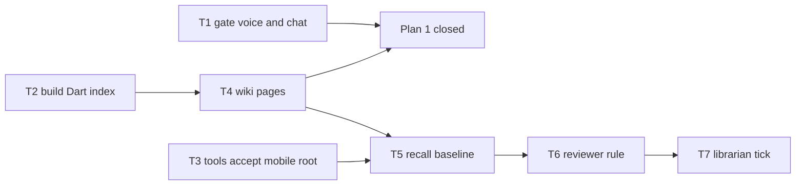

# 2026.10.20 Plans 1 and 2: bringing lupin-mobile level with lupin

Rick's broadcast of 2026-10-20 asks each manager to finish Plan 1 (the documentation rewrite) and Plan 2 (the code wiki and the reuse lookup). This page is the mobile half.

**Verdict.** Plan 1 is nearly finished on mobile. Plan 2 has not started on mobile, but lupin already built most of what mobile needs, so the work is to **run and open up lupin's tools, not to write new ones**.

**Status 2026-10-21.** Plan 1 is done on mobile. Plan 2 is done on mobile except the librarian tick (W-G), which Cheech's crew is building. The table below is current.

The two plans live in the lupin repo:

- Plan 1: `lupin/src/rnd/v0.2.2/2026.09.30-lupin-af-documentation-rewrite-plan/` (mobile track is §10a, M0 to M4)
- Plan 2: `lupin/src/rnd/v0.2.2/2026.09.30-wiki-and-jev-for-code-reuse-review/` (phases W-A to W-H; ruling E9 puts mobile's Dart index in W-B)

## 1. Where mobile stands

| Plan step | Mobile state | Evidence |
|---|---|---|
| P1 M0 to M2 (measure, Dart standard, pilot) | done | `src/docs/docstring-standard.md`, history 2026-10-10 |
| P1 M3 sweep | done | `lib/features/voice` and `lib/features/chat` are empty leftover folders with no tracked files (voice deleted in `222e9a0`), so T1 is void |
| P1 M4 ratchet (hook and merge gate) | done | `tool/merge_gate.py`, `tool/hooks/pre-commit` |
| P1 markdown cleanup and blocking | done | history 2026-10-13 and 2026-10-14 |
| P1 Phase 6 R&D ledger | done | `src/docs/rnd-ledger.tsv`, 115 rows |
| P1 claim checker on the Dart set | dropped | Rick ruled on 2026-10-20 to drop the gate (row `3740dd5b`, Mr. Radio's DM); mobile's Dart docs rest on the strict doc linter and the merge gate |
| P1 Phase 5 reference docs as capability pages | done | the P2 W-D wiki below |
| P2 W-B Dart symbol index | done | 2609 entries, generation gen-399b92b103, row `dad36ae1` |
| P2 W-B duplicate finder | not available for Dart | `dups` reads Python, JS and TS only |
| P2 W-C the exact lookup tools | done | lupin `fc0517fc6`: `index_readable()`; live `check_exists` receipt `0dc2bff53112e732`, row `55013536` |
| P2 W-D wiki (`INDEX.md`, capability pages) | done | 67 pages, merged at `dee7e11`; 16 orphans with lupin's lint; row `f45cf2cb` |
| P2 W-E recall baseline | done | twins 37/40, random negatives 0/200; `projects-data/lupin-mobile/reuse-review/negatives-2026.10.20/`; misses on lupin row `74d0db47` |
| P2 W-F reviewer skill and receipt rule | done | `.claude/skills/reuse-reviewer/SKILL.md`, merged at `d925b94` |
| P2 W-G librarian daily tick | in progress | Cheech's row `874dff1a`; mobile rollup rows go to Tiffany |

## 2. What we reuse from lupin, and what changes there

Nothing below is reimplemented in mobile.

| Lupin piece | Use on mobile | Change needed |
|---|---|---|
| `cosa/repo/symindex` (`build`, `fresh`, `lint`) | run with the mobile root; the index goes to `projects-data/lupin-mobile/reuse-review/index/lupin-mobile`, IDs prefixed `lupin-mobile:` | none for `build`; check its Dart fixture tests pass |
| `wiki_lint.py` | run over mobile's `src/docs/wiki/` | none expected |
| `check_exists`, `read_capability`, `replay` | answer for mobile when the caller passes the mobile root | one predicate, "a registered repo with a built index", at every `NOT_LUPIN_TREE` site: `reuse_tools.py` lines 1042, 1281, 1422, 1446, 1595 and `reuse_flip_run.py:172`. María owns this part (her DM, 2026-10-20) |
| `fetch_similar` vector stage | leave lupin only for now | ruling R13 says Dart stays out until lupin is proven |
| `dups` | add Dart later | a Dart branch in `dups.py`; low priority |
| reuse-reviewer skill and receipt rule (W-F) | copy the rule into mobile's review briefs | none |
| librarian tick (W-G) | add mobile's wiki to the daily lint | config or a second corpus entry |

## 3. The tickets, in order

| # | Ticket | Owner | Plan step |
|---|---|---|---|
| T1 | Void: both folders hold no tracked files | none | P1 M3/M4 |
| T2 | Build and publish mobile's Dart index with lupin's `symindex`; check 30 modules by hand against an independent count | Tiffany's crew | P2 W-B, E9 |
| T3 | Let the lookup tools answer for a registered external repo (mobile first). Tests: lupin, mobile with an index, mobile without one, an unregistered repo; then, after a seat restart (a `/clear` does not reload the MCP), `check_exists` answers a Dart symbol | María after her P0 `30257e87`, Tiffany reviews | P2 W-C |
| T4 | Name mobile's capabilities, write `src/docs/wiki/INDEX.md` and the pages, pass `wiki_lint` | Tiffany's crew; Rick approves the names | P2 W-D, P1 Phase 5 |
| T5 | Recall baseline on mobile: known twins and negatives, exact stages only | Tiffany's crew | P2 W-E |
| T6 | Reuse receipt rule in mobile's author and reviewer briefs | Tiffany | P2 W-F |
| T7 | Librarian daily tick covers mobile's wiki | Cheech's librarian, Tiffany asks | P2 W-G |

## 4. One decision for Rick

Ruling R13 keeps Dart out of the candidate-stage plan. The tickets above add mobile to the **exact** lookups (index, `check_exists`, `read_capability`) and leave the vector stage of `fetch_similar` lupin only. Rick decides whether that reading of R13 holds.

Recommended: exact lookups now, vectors after lupin is proven. It gives reviewers mobile lookups this week and keeps R13's intent.

**Ruled**: Rick, card, 2026-10-20, first-hand (answered, no default): "Exact lookups now (Recommended)".
