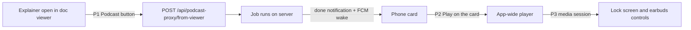
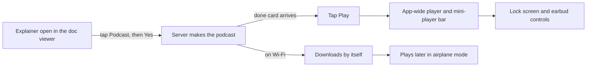

# Explainer to podcast to playback, on the phone

Rick filed row `3469e9db` (P0, accountable manager Mr. Radio) on 2026-10-31: one seamless loop on the phone
from an explainer document to a podcast you can listen to. Mr. Radio's design owns the server and the
Drive upload; this plan owns only the phone.

## The contract with the server (agreed with Mr. Radio, DM 2026-10-31 14:12)

- The phone depends only on the done notification's **existing audio links**.
- `drive_folder_link` is a new **optional** artifact field. The phone ignores it (Rick, below).
- Anything else the phone needs from the server is raised with Mr. Radio before it is built.

## Rick's ruling on Google Drive (voice, 2026-10-31 about 14:18 EDT)

Drive is for the **desktop** only: create on the desktop, Drive carries the mp3 to the phone, listen on a walk.
A podcast started **on the phone** plays straight from the Lupin server's existing audio link; the phone
never reads or writes Drive. So P4 drops `drive_folder_link`: the phone ignores that field.

## What exists today (read in code at `97d3f58`, nothing run)

| Piece | State | Where |
|---|---|---|
| Podcast submit from a typed path | works | `lib/features/agentic/presentation/podcast_generator_form.dart` |
| Research chained into podcast | works | `lib/features/agentic/presentation/research_to_podcast_form.dart` |
| Doc viewer (explainers open here) | works; actions are download and open folder only | `lib/features/docs/presentation/doc_viewer_screen.dart:295` |
| Playback of a finished podcast | works only on the job detail screen | `lib/features/queue/presentation/job_detail_screen.dart:76` |
| Player lifetime | tied to the widget; leaving the screen disposes the player and stops the audio | `lib/features/artifacts/audio_artifact_player.dart:134` |
| Lock-screen or background playback | none: `audioplayers` only, no media session, no foreground service permission | `pubspec.yaml`, `android/app/src/main/AndroidManifest.xml` |
| FCM wake when the job finishes | works | server `fcm_wake_service.py` |

## The gaps, and the work for each

| # | Gap | Work | Size |
|---|---|---|---|
| P1 | No one-tap start from an explainer: the form wants a typed path | A **Podcast** button in the doc viewer's app bar. One tap opens an in-app "Podcast <name>? Yes / No" sheet, then calls `GET /api/podcast-proxy/from-viewer/check` and `POST /api/podcast-proxy/from-viewer` with `<scope>/<path>`, under the user's login token (the API key gets a 403). A refused check shows an in-app error; a 409 "spent" means already started, so follow its `job_id`. | small |
| P2 | Audio stops when you leave the job screen | Lift the player out of the widget into one app-wide player service with a mini-player bar, so the podcast keeps playing while Rick moves around the app. The job detail screen and the done card both start it. | medium |
| P3 | No lock-screen or background playback | Add a media session (`audio_service`, or `just_audio` with `just_audio_background`) with the foreground-service permission, so playback survives the screen locking and earbud buttons work. | medium |
| P4 | The done card has no play control | A Play action on the done notification card that hands the audio link to the P2 player. | small |

## Review fixes (Tiberius, 2026-10-31 14:20, all accepted)

- **Audio source.** The card's link is a web path (`/app/audio?path=`, lupin `orchestrator.py:1183`). The phone plays the job's server path (`job_detail_screen.dart:73`), downloading the whole mp3 first (`audio_artifact_player.dart:156`). The player's `play(path, title)` takes that server path. Download-then-play stays, because it lets a walk run offline; show a loading state while it downloads.
- **Android 14.** The manifest needs `FOREGROUND_SERVICE` and `FOREGROUND_SERVICE_MEDIA_PLAYBACK`.
- **Audio focus (Tiffany's ruling).** When spoken TTS or an FCM wake item plays (`streaming_tts_player.dart`, `fcm_wake_chain.dart`), the podcast pauses and then resumes; nothing talks over it.
- **FCM.** The wake only exists in builds with FCM on (`fcm_bootstrap.dart:40` defaults to off), so the APK goes through `build-apk-on-server.sh`, which turns it on by default.
- **Tests added.** A refused check shows an error (the check runs on tap, not on every document open), the 409 path, and the pause and resume around TTS.

**Out of scope here:** the Drive upload (server, Mr. Radio), offline download of the mp3 (backlog), and the
spoken yes (Rick deprioritized it, 2026-10-08).

## Answered (Mr. Radio, DM 2026-10-31 14:14)

The server already accepts it: `GET /api/podcast-proxy/from-viewer/check`, then
`POST /api/podcast-proxy/from-viewer` with the document as `<scope>/<path>`
(lupin `src/cosa/rest/routers/podcast_proxy.py`). The web caller to copy is
`src/lupin_app/static/js/multiplexer/docPodcast/docPodcast.ts`. No server change is needed for P1.

## Open question for Mr. Radio (before P1 is built), kept for the record

The doc viewer knows a document as project plus relative path. P1 needs the server to accept that form,
or to translate it to a file path through the viewer's scope check (his 2026-10-08 plan, step 2). If the
desktop Podcast button already added that translation, the phone reuses it; otherwise it is one server
change he owns.

## Tests (the phone's merge gate)

| Tier | What |
|---|---|
| Widget | P1 button shows on a document, the sheet confirms, Yes submits with the right command and path, No submits nothing |
| Unit | P2 player service: start, pause, switch track, survives screen pop; P4 card action routes to it |
| Integration | full suite through `./flutter.sh test`, `tool/merge_gate.py` |
| Device (Rick) | P3 only: lock the screen mid-podcast and press the earbud button. Real-device audio cannot be widget-tested. |

## Staffing, proposed (skeleton crew is being lifted)

- **Two implementers in parallel**: one on P1 + P4 (UI, small), one on P2 + P3 (player, medium; P3 builds on P2).
- **One reviewer** for both branches, including the reuse review.
- Tiffany manages, merges, and rebuilds the APK after each merge.
- Nothing is spawned until Mr. Radio has read this and answered the open question.
- Skeleton crew was still on at 2026-10-31 18:15 UTC (switch set 15:49 UTC; the stop hook says "until 17:00 EDT, M-F"). While it is on, no seats are spawned. If it stays on, Tiffany builds P2 then P3 herself (they need nothing from the server), then P1 and P4 once Mr. Radio has answered.

## What got built this afternoon (explainer, 2026-10-31 evening)

By 15:30 the whole loop was built, reviewed and merged on `wip-v0.2.2-2026.09.30-tracking-lupin` at `7aaeeaa`.
APK build 2, with push wake-ups on, is waiting on the server. Nothing has been pushed.

### The loop, as you will use it

### Three pieces of work, three rows

| Row | Seat | What it does | Merged |
|---|---|---|---|
| `049d914a` | Krishna | One podcast player for the whole app, with a mini-player bar. Playback continues with the screen locked, and the earbud button works. The podcast **pauses** while the app speaks or a wake-up talks, then picks up where it left off. | `152146a`, `f8f5e27` |
| `0c23edab` | Chloé | A **Podcast** button in the doc viewer. It asks the server first and confirms the cost with you; if the server refuses, you see the reason. If a podcast for that document is already being made, the app follows that job instead of starting a second one. The "podcast finished" card has a **Play** button. | `65ef6d8` |
| `24a39e97` | Krishna | Offline listening, from your voice request. Podcasts are saved to a folder that lasts, not a temporary one. A finished podcast downloads by itself when you're on Wi-Fi. On mobile data the app asks before downloading. A mark shows what's downloaded, and files older than 30 days are cleaned up. | `7aaeeaa` |

Tiberius reviewed every branch before it merged, and I ran the full merge gate on each.

### What review caught before you saw it

- **Two different podcasts could share one file name.** `io/a-b.mp3` and `io/a/b.mp3` both flattened to the same name. The file name is now the encoded server path, which can't collide.
- **A second podcast with the same title would just resume the first.** The player now identifies a track by its path, not its title.
- **A wake-up lowered the podcast volume instead of pausing it.** The audio session is now set so that Android pauses it.
- **My own first answer on offline listening was wrong.** I said a played podcast could be replayed offline. It couldn't: each play downloaded the file again into a temporary folder. That is why row `24a39e97` exists.

### One process slip, and the fix

I merged the first player branch before the full gate had finished, and the gate then failed. Part of the failure was stale packages in my checkout. The rest was three test ids that had moved to a new file, so the record of previously-passing tests needed updating. Krishna updated that record in `9ed83c9`, and I read its diff line by line. Every merge since then ran the gate first, in a scratch worktree, and then fast-forwarded.

### Google Drive, per your ruling

Drive is for the **desktop** only: you make a podcast on the desktop, Drive carries it, and you listen on the phone. The phone doesn't touch Drive. It plays podcasts it started directly from the Lupin server. Mr. Radio owns the Drive side.

### What's left

Only your seven-step phone check on build 2, listed on row `3469e9db`. If any step fails, I'll staff a fix from the saved notes in `io/mementos/`.
