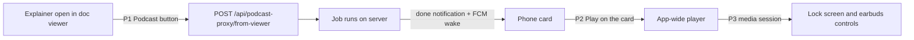
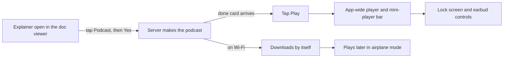

# Explainer to podcast to playback, on the phone

Rick filed row `3469e9db` (P0, accountable manager Mr. Radio) on 2026-10-31: one seamless loop on the phone
from an explainer document to a podcast you can listen to. Mr. Radio's design owns the server and the
Drive upload; this plan owns only the phone.

## The contract with the server (agreed with Mr. Radio, DM 2026-10-31 14:12)

- The phone depends only on the done notification's **existing audio links**.
- `drive_folder_link` is a new **optional** artifact field. The phone ignores it (Rick, below).
- Anything else the phone needs from the server is raised with Mr. Radio before it is built.

## Rick's ruling on Google Drive (voice, 2026-10-31 about 14:18 EDT)

Drive is for the **desktop** only: create on the desktop, Drive carries the mp3 to the phone, listen on a walk.
A podcast started **on the phone** plays straight from the Lupin server's existing audio link; the phone
never reads or writes Drive. So P4 drops `drive_folder_link`: the phone ignores that field.

## What exists today (read in code at `97d3f58`, nothing run)

| Piece | State | Where |
|---|---|---|
| Podcast submit from a typed path | works | `lib/features/agentic/presentation/podcast_generator_form.dart` |
| Research chained into podcast | works | `lib/features/agentic/presentation/research_to_podcast_form.dart` |
| Doc viewer (explainers open here) | works; actions are download and open folder only | `lib/features/docs/presentation/doc_viewer_screen.dart:295` |
| Playback of a finished podcast | works only on the job detail screen | `lib/features/queue/presentation/job_detail_screen.dart:76` |
| Player lifetime | tied to the widget; leaving the screen disposes the player and stops the audio | `lib/features/artifacts/audio_artifact_player.dart:134` |
| Lock-screen or background playback | none: `audioplayers` only, no media session, no foreground service permission | `pubspec.yaml`, `android/app/src/main/AndroidManifest.xml` |
| FCM wake when the job finishes | works | server `fcm_wake_service.py` |

## The gaps, and the work for each



| # | Gap | Work | Size |
|---|---|---|---|
| P1 | No one-tap start from an explainer: the form wants a typed path | A **Podcast** button in the doc viewer's app bar. One tap opens an in-app "Podcast <name>? Yes / No" sheet, then calls `GET /api/podcast-proxy/from-viewer/check` and `POST /api/podcast-proxy/from-viewer` with `<scope>/<path>`, under the user's login token (the API key gets a 403). A refused check shows an in-app error; a 409 "spent" means already started, so follow its `job_id`. | small |
| P2 | Audio stops when you leave the job screen | Lift the player out of the widget into one app-wide player service with a mini-player bar, so the podcast keeps playing while Rick moves around the app. The job detail screen and the done card both start it. | medium |
| P3 | No lock-screen or background playback | Add a media session (`audio_service`, or `just_audio` with `just_audio_background`) with the foreground-service permission, so playback survives the screen locking and earbud buttons work. | medium |
| P4 | The done card has no play control | A Play action on the done notification card that hands the audio link to the P2 player. | small |

## Review fixes (Tiberius, 2026-10-31 14:20, all accepted)

- **Audio source.** The card's link is a web path (`/app/audio?path=`, lupin `orchestrator.py:1183`). The phone plays the job's server path (`job_detail_screen.dart:73`), downloading the whole mp3 first (`audio_artifact_player.dart:156`). The player's `play(path, title)` takes that server path. Download-then-play stays, because it lets a walk run offline; show a loading state while it downloads.
- **Android 14.** The manifest needs `FOREGROUND_SERVICE` and `FOREGROUND_SERVICE_MEDIA_PLAYBACK`.
- **Audio focus (Tiffany's ruling).** When spoken TTS or an FCM wake item plays (`streaming_tts_player.dart`, `fcm_wake_chain.dart`), the podcast pauses and then resumes; nothing talks over it.
- **FCM.** The wake only exists in builds with FCM on (`fcm_bootstrap.dart:40` defaults to off), so the APK goes through `build-apk-on-server.sh`, which turns it on by default.
- **Tests added.** A refused check shows an error (the check runs on tap, not on every document open), the 409 path, and the pause and resume around TTS.

**Out of scope here:** the Drive upload (server, Mr. Radio), offline download of the mp3 (backlog), and the
spoken yes (Rick deprioritized it, 2026-10-08).

## Answered (Mr. Radio, DM 2026-10-31 14:14)

The server already accepts it: `GET /api/podcast-proxy/from-viewer/check`, then
`POST /api/podcast-proxy/from-viewer` with the document as `<scope>/<path>`
(lupin `src/cosa/rest/routers/podcast_proxy.py`). The web caller to copy is
`src/lupin_app/static/js/multiplexer/docPodcast/docPodcast.ts`. No server change is needed for P1.

## Open question for Mr. Radio (before P1 is built), kept for the record

The doc viewer knows a document as project plus relative path. P1 needs the server to accept that form,
or to translate it to a file path through the viewer's scope check (his 2026-10-08 plan, step 2). If the
desktop Podcast button already added that translation, the phone reuses it; otherwise it is one server
change he owns.

## Tests (the phone's merge gate)

| Tier | What |
|---|---|
| Widget | P1 button shows on a document, the sheet confirms, Yes submits with the right command and path, No submits nothing |
| Unit | P2 player service: start, pause, switch track, survives screen pop; P4 card action routes to it |
| Integration | full suite through `./flutter.sh test`, `tool/merge_gate.py` |
| Device (Rick) | P3 only: lock the screen mid-podcast and press the earbud button. Real-device audio cannot be widget-tested. |

## Staffing, proposed (skeleton crew is being lifted)

- **Two implementers in parallel**: one on P1 + P4 (UI, small), one on P2 + P3 (player, medium; P3 builds on P2).
- **One reviewer** for both branches, including the reuse review.
- Tiffany manages, merges, and rebuilds the APK after each merge.
- Nothing is spawned until Mr. Radio has read this and answered the open question.
- Skeleton crew was still on at 2026-10-31 18:15 UTC (switch set 15:49 UTC; the stop hook says "until 17:00 EDT, M-F"). While it is on, no seats are spawned. If it stays on, Tiffany builds P2 then P3 herself (they need nothing from the server), then P1 and P4 once Mr. Radio has answered.

## What got built this afternoon (explainer, 2026-10-31 evening)

By 15:30 the whole loop was built, reviewed and merged on `wip-v0.2.2-2026.09.30-tracking-lupin` at `7aaeeaa`.
APK build 2, with push wake-ups on, is waiting on the server. Nothing has been pushed.

### The loop, as you will use it



### Three pieces of work, three rows

| Row | Seat | What it does | Merged |
|---|---|---|---|
| `049d914a` | Krishna | One podcast player for the whole app, with a mini-player bar. Playback continues with the screen locked, and the earbud button works. The podcast **pauses** while the app speaks or a wake-up talks, then picks up where it left off. | `152146a`, `f8f5e27` |
| `0c23edab` | Chloé | A **Podcast** button in the doc viewer. It asks the server first and confirms the cost with you; if the server refuses, you see the reason. If a podcast for that document is already being made, the app follows that job instead of starting a second one. The "podcast finished" card has a **Play** button. | `65ef6d8` |
| `24a39e97` | Krishna | Offline listening, from your voice request. Podcasts are saved to a folder that lasts, not a temporary one. A finished podcast downloads by itself when you're on Wi-Fi. On mobile data the app asks before downloading. A mark shows what's downloaded, and files older than 30 days are cleaned up. | `7aaeeaa` |

Tiberius reviewed every branch before it merged, and I ran the full merge gate on each.

### What review caught before you saw it

- **Two different podcasts could share one file name.** `io/a-b.mp3` and `io/a/b.mp3` both flattened to the same name. The file name is now the encoded server path, which can't collide.
- **A second podcast with the same title would just resume the first.** The player now identifies a track by its path, not its title.
- **A wake-up lowered the podcast volume instead of pausing it.** The audio session is now set so that Android pauses it.
- **My own first answer on offline listening was wrong.** I said a played podcast could be replayed offline. It couldn't: each play downloaded the file again into a temporary folder. That is why row `24a39e97` exists.

### One process slip, and the fix

I merged the first player branch before the full gate had finished, and the gate then failed. Part of the failure was stale packages in my checkout. The rest was three test ids that had moved to a new file, so the record of previously-passing tests needed updating. Krishna updated that record in `9ed83c9`, and I read its diff line by line. Every merge since then ran the gate first, in a scratch worktree, and then fast-forwarded.

### Google Drive, per your ruling

Drive is for the **desktop** only: you make a podcast on the desktop, Drive carries it, and you listen on the phone. The phone doesn't touch Drive. It plays podcasts it started directly from the Lupin server. Mr. Radio owns the Drive side.

### What's left

Only your seven-step phone check on build 2, listed on row `3469e9db`. If any step fails, I'll staff a fix from the saved notes in `io/mementos/`.

## Earbud taps: research (row 3d1bb844)

Research only; no app code changed. Author: Krishna, 2026-10-31. Basis: Google's Pixel Buds help page, the audio_service 0.18.19 and just_audio_background 0.0.1-beta.17 source in `~/.pub-cache`, and our manifest and `lib/main.dart`. **Nothing here was observed on Rick's phone.** Where a statement rests on general Android knowledge rather than a file I read, it says so.

### Verdict

1. **Single tap should already work through our setup.** The plugin handles a play/pause media key, and our manifest has the receiver. So the fault is probably upstream of our code (taps never become a media key, or another app holds the buttons). The two-minute test below tells which.
2. **Double tap will never rewind as built.** Google's default for the Pro 2 double tap is *next track*, and our player has a one-item queue, so next track does nothing. Making it rewind needs code, not config.
3. **Recommendation:** run the diagnostic first (Rick, two minutes). Then, if single tap is confirmed to arrive, change the handler so *next* means "back 15 s" (option C below, small if we stay on just_audio_background's hooks, medium if we replace it).

### (1) What Pixel Buds Pro 2 send

Google's help page (https://support.google.com/googlepixelbuds/answer/7685360) lists the Pro 2 defaults:

| Gesture | Default action |
|---|---|
| Single tap | Play or pause; answer a call |
| Double tap | **Next track**; end or reject a call |
| Triple tap | **Previous track** or repeat the current one |
| Swipe | Volume |
| Press and hold | Cycle ANC / Transparency / Adaptive Audio (can be changed to Assistant in the Pixel Buds app) |

The page says all gestures can be switched off ("turn them on or off") and that the Pro 2 gestures are customizable, but it names only press-and-hold as remappable. I could not confirm that double tap can be remapped. In-ear detection pauses and resumes audio when a bud is removed or replaced, on its own and with no tap.

How a tap reaches Android (general Android knowledge, not read from source here): the buds send AVRCP passthrough commands over Bluetooth; the phone's Bluetooth stack turns them into media key events (`KEYCODE_MEDIA_PLAY_PAUSE`, `KEYCODE_MEDIA_NEXT`, `KEYCODE_MEDIA_PREVIOUS`) and hands them to Android's media session service, which delivers them to one session. So the tap is a media key by the time apps see it, not a vendor intent. Exceptions: touch controls switched off in the Pixel Buds app, or a gesture reassigned to Assistant, never produce a key.

### (2) Would it reach our MediaSession, and every reason it might not

What our side has:

- `android/app/src/main/AndroidManifest.xml:38-53`: `com.ryanheise.audioservice.AudioService` (exported, `mediaPlayback`, MediaBrowserService action) and `com.ryanheise.audioservice.MediaButtonReceiver` with `android.intent.action.MEDIA_BUTTON`. `FOREGROUND_SERVICE` and `FOREGROUND_SERVICE_MEDIA_PLAYBACK` permissions are present (lines 9-10). The receiver is there.
- `lib/main.dart:34-40`: `JustAudioBackground.init(... androidNotificationOngoing: true, rewindInterval: 15 s)`. Defaults left on: `androidResumeOnClick: true`, `androidStopForegroundOnPause: true` (just_audio_background.dart:36,45).
- `lib/services/audio/just_audio_playback_engine.dart:29`: `AudioSource.file(..., tag: MediaItem(...))`, a single item, so no queue.

What the plugin does with a key (audio_service 0.18.19, `android/.../AudioService.java:944-985`): `MediaSessionCallback.onMediaButtonEvent` returns false when `listener == null`, then on `ACTION_DOWN` forwards `KEYCODE_MEDIA_PLAY/PAUSE/PLAY_PAUSE/HEADSETHOOK/NEXT/PREVIOUS` to Dart as `onClick` (`eventToButton`, lines 985-998: play-pause and headset hook become `MediaButton.media`, next and previous map to themselves). Only `KEYCODE_MEDIA_REWIND`, `FAST_FORWARD` and `STOP` go to their own methods (lines 957-965). The Dart default `BaseAudioHandler.click` (`audio_service.dart`, `click` in the BaseAudioHandler class, about line 2191 in the delegating wrapper and the switch at the click implementation) does: media → pause if playing else play; next → `skipToNext()`; previous → `skipToPrevious()`. `just_audio_background` does not override `click`, and its `skipToNext/skipToPrevious` (just_audio_background.dart:625-636) act only `if (hasNext)` / `if (hasPrevious)`.

Reasons single tap might fail even though the wiring is right:

| # | Reason | Check |
|---|---|---|
| a | Taps never become a media key: touch controls off in the Pixel Buds app, or the buds route the gesture elsewhere | No key lines in logcat when tapping |
| b | Another app's session holds the media button (a podcast/music app, YouTube, Assistant, or a stale session) and Android delivers the key to it | `dumpsys media_session` names a different package as the media button session |
| c | Our session is not the one Android thinks is current: `mediaSession.setActive(true)` happens when playback starts (AudioService.java:708, `enterPlayingState`) and is cleared at stop (743-748). After the user stops, or the system kills the process, no active session exists until the receiver relaunches the service | Package `ai.deepily.lupin_mobile` absent from the session list |
| d | The key arrives but the handler ignores it: `onMediaButtonEvent` returns false if `listener == null` (service not bound to Dart, e.g. engine not up) | Key logged for our package but no state change |
| e | Audio focus: our session config is `AudioSessionConfiguration.speech()` with pause-on-duck (`podcast_audio_session.dart`); a transient focus holder (call, Assistant, a ding) can leave us paused and a tap then *plays*, which looks like "nothing" if focus is denied | `dumpsys audio` focus stack |
| f | Android 13+ and 14 media-key routing differs for apps without an active foreground media notification; with `androidStopForegroundOnPause: true` the service leaves the foreground on pause (general knowledge, unverified here), which is when a paused app loses routing priority first | Test paused vs playing |

### (3) Foreground vs background vs locked

Media keys do not depend on the app being in the foreground: Android delivers them to the media button session, and the notification-backed foreground service keeps our process alive while *playing*. Locked screen is the same path. The practical differences are all about whether our session is the current one (rows b, c, f above): while playing, with our notification showing, we should get the key in all three states; after a pause, or a long idle with the service stopped, we are the likeliest to lose it. The diagnostic below should be run in two states: playing, and paused ~1 minute, screen locked each time.

### (4) Double tap

Double tap = `KEYCODE_MEDIA_NEXT` (Google's default) → `click(MediaButton.next)` → `skipToNext()` → no-op, because our queue has one item (`hasNext` false). Triple tap = previous → `skipToPrevious()` → also a no-op. The `rewindInterval` in `main.dart:38-39` helps only a device that sends `KEYCODE_MEDIA_REWIND`; the Pro 2 does not send one in its default mapping. So: rewind cannot come from a double tap unless we **reinterpret next (or previous)**. Whether Google lets Rick remap double tap to something else is not confirmed (see section 1).

### (5) Options

| Option | What | Cost | Catch |
|---|---|---|---|
| A. Do nothing | Single tap probably already fine once the cause in (2) is fixed | none | no rewind |
| B. Buds-side remap | Pixel Buds app → Touch controls | none | only press-and-hold is documented as remappable; there is no rewind action in any case |
| C. Reinterpret next/previous in our handler | Next = back 15 s (or +30 s), previous = back 15 s | small to medium | See below |
| D. Fake queue | Give the player a 3-item queue so next/previous exist, and treat arriving at the neighbour as a seek | small but hacky | a skip is a track change; glitches, and the notification shows prev/next buttons |
| E. Native key handling | Own `MediaSession.Callback` in Kotlin | large | duplicates what audio_service already does; not recommended |

Detail on C. just_audio_background builds its own handler (`_PlayerAudioHandler extends BaseAudioHandler`, line 347) inside `JustAudioBackground.init` (line 98: `AudioService.init(builder: () => SwitchAudioHandler(BaseAudioHandler()))`), so we cannot subclass it from outside. Two ways: (C1) drop `just_audio_background` and call `AudioService.init` ourselves with a small `BaseAudioHandler` that drives our `PodcastPlayerService` (`skipBack`/`play`/`pause` already exist, `podcast_player_service.dart:176,229`) and overrides `click` and `skipToNext`; this is medium (one handler class, one init change, replaces the plugin's player-to-notification plumbing, so play/pause/seek state broadcast must be rebuilt, plus a new unit test tier) and also removes risk d. (C2) keep the plugin, override nothing, and use D. C1 is the clean one. The cost: it changes the audio stack the lock-screen work (row 3469e9db P3) just shipped, so it needs a device pass.

Recommendation: do not build C until the diagnostic shows the single tap *arrives*. If the key never reaches Android (row a) or a competing session wins (row b), C buys nothing for the double tap either.

### Diagnostic for Rick (under two minutes)

Phone on USB with debugging on, laptop with adb. Start a podcast, then:

```bash
adb logcat -c
adb logcat -v time | grep -i -E "avrcp|MediaSessionService|media_button|MEDIA_BUTTON|KEYCODE_MEDIA|HEADSETHOOK|ai.deepily.lupin_mobile|audioservice"
```

Single-tap the bud once, double-tap once, wait 5 s, Ctrl-C. Repeat with the screen locked and again after the podcast has been paused for a minute. Then, with the podcast paused and the screen on:

```bash
adb shell dumpsys media_session | grep -i -E -A8 "media button session|Sessions Stack"
```

Reading it:

| What you see | Meaning |
|---|---|
| No avrcp/key lines at all when tapping | Case a: the gesture never became a media key (touch controls off, or a Pixel Buds setting). Fix is on the buds, not in our app |
| Key lines, and the media button session is another package | Case b: that app is stealing the button. Close or stop it, and note its name |
| Key lines, session is `ai.deepily.lupin_mobile`, but nothing happens | Case d: handler problem; send the full log to me |
| Our package missing from the session list when paused or locked | Case c/f: session dropped; the fix is keeping the service in the foreground while paused (`androidStopForegroundOnPause: false`), a one-line change |
| Single tap works, double tap does nothing | As predicted: next track on a one-item queue; option C |

Paste the log and the `dumpsys` output to Tiffany; I will read it.
